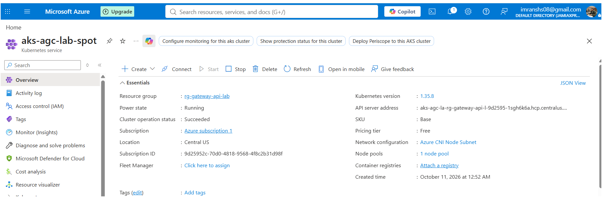
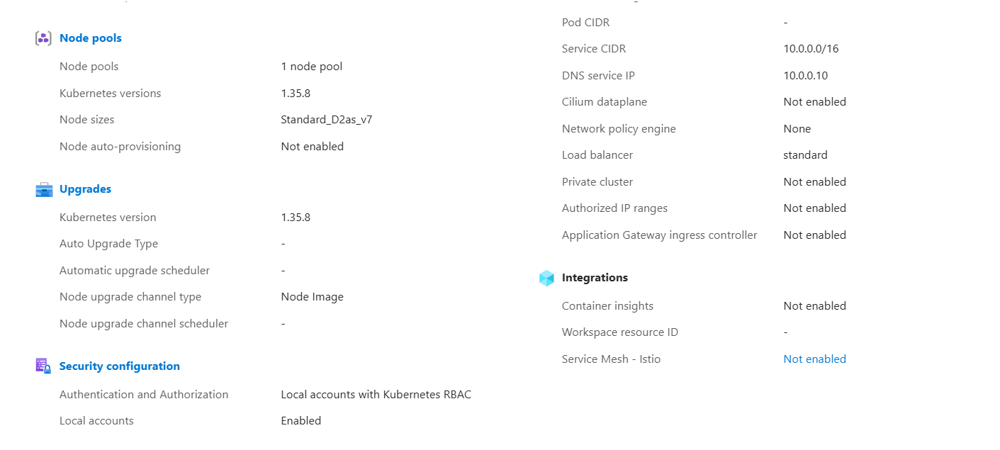
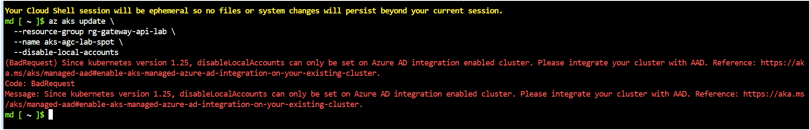
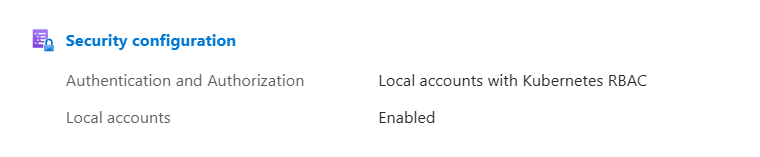
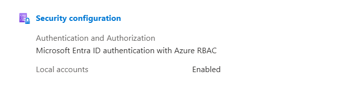
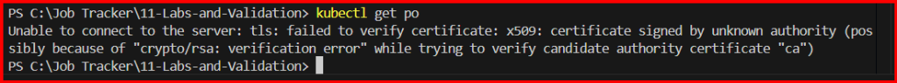
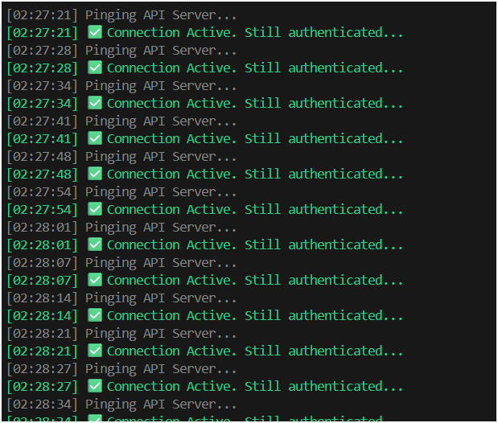
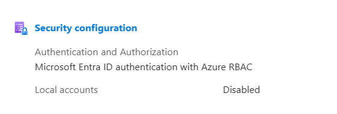

# 🔐 SRE Masterclass Sandbox: The Insider Threat (AKS Zero-Trust)

This lab is a cinematic, end-to-end execution guide demonstrating a classic "Insider Threat" scenario. We will simulate three distinct actors: a Senior Admin (`Alex`), an Insider Threat (`Imran Ahmad`), and an External Hacker (`saifi`). We will prove mathematically why AKS Local Accounts represent a critical backdoor, how credentials can be blindly copy-pasted, and how to permanently board up the API Server using Zero-Trust Architecture.

---

## 🎭 The Cast of Characters
* **The Architect (Alex):** `jamiaxpress@gmail.com`
* **The Insider Threat (Imran Ahmad):** `imranshs08@gmail.com`
* **The External Threat (Hacker):** `saifi` (Zero Azure Access)
* **The Target Workload:** A simple `nginx` deployment.

---

## 🎬 Act I: Provisioning & Onboarding

### Step 1 & 2: The Architect Deploys the Cluster (With The Backdoor)
Log into your local CLI as **`jamiaxpress@gmail.com`**. We will deploy a standard AKS cluster. By default, this enables Azure RBAC *and* inherently leaves the Local Accounts (static certificates) wide open.

> **Enterprise DO:** Always explicitly declare `--disable-local-accounts` during provisioning for production clusters.
> **Enterprise DON'T:** Never assume Entra ID integration automatically secures the API Server. It fundamentally does not.




```bash
# Define Constants
RG_NAME="rg-gateway-api-lab"
LOCATION="centralus"
CLUSTER_NAME="aks-agc-lab-spot"

# 1. Spin up the Resource Group
az group create --name "$RG_NAME" --location "$LOCATION"

# 1. Spin up the Resource Group
az group create --name "$RG_NAME" --location "$LOCATION"

# 2. Provision the Cluster (Local Accounts Enabled)
az aks create     --resource-group "$RG_NAME"     --name "$CLUSTER_NAME"     --node-count 1 --node-vm-size Standard_D4ds_v7     --generate-ssh-keys     --network-plugin azure     --enable-managed-identity     --enable-aad     --enable-azure-rbac

```

### Step 3 & 4: Inviting & Granting Permission to the Employee
The Architect (`Alex`) now invites the Employee (`Imran Ahmad`) to help manage the cluster.

> **Enterprise DO:** Assign permissions strictly via Entra ID Security Groups, rather than individual direct user mapping.
> **Enterprise DON'T:** Do not grant 'Cluster Admin' for trivial tasks; utilize granular Azure RBAC namespaces.

```bash
# 3. Get the Object ID of the Insider Threat User (Guest accounts require mail filtering)
EMP_EMAIL="imranshs08@gmail.com"
EMP_ID=$(az ad user list --filter "mail eq '$EMP_EMAIL'" --query "[0].id" -o tsv)

# 4. Grant the Employee 'Azure Kubernetes Service RBAC Cluster Admin' rights
SUB_ID=$(az account show --query id -o tsv)
az role assignment create \
  --role "Azure Kubernetes Service RBAC Cluster Admin" \
  --assignee-object-id $EMP_ID \
  --assignee-principal-type User \
  --scope /subscriptions/$SUB_ID/resourceGroups/$RG_NAME/providers/Microsoft.ContainerService/managedClusters/$CLUSTER_NAME
```

---

## 🎬 Act II: The Sabotage & Data Exfiltration

### Step 5: The Insider Steals the God-Key
The Employee (`Imran Ahmad`) intends to quit the company, but wants to maintain a backdoor. They sign into Azure CLI on their laptop and intentionally use the `--admin` flag to pull the raw, static RSA certificate instead of their Entra ID token!

```bash
# The Insider executes this on their terminal
az aks get-credentials --resource-group rg-gateway-api-lab --name aks-agc-lab-spot --admin --file insecure-kubeconfig

# Verify the compromised context has been downloaded
kubectl config current-context --kubeconfig insecure-kubeconfig
# Output will be: aks-agc-lab-spot-admin (They now hold the static God-Key!)
```

### 🧠 SRE Deep-Dive: The Exfiltration Vector
Before deployment, let's understand exactly *what* the Insider just stole. 

**How to Expose the Stolen Payload:**
By default, Kubernetes hides these certificates and output `REDACTED`. To force the raw cryptographic Base64 strings to render in your terminal, the Insider executes the `--raw` dump command:
```bash
kubectl config view --kubeconfig insecure-kubeconfig --raw
```

**Example of the Stolen Payload:**
```yaml
apiVersion: v1
clusters:
- cluster:
    certificate-authority-data: LS0tLS1... (Base64 CA)
    server: https://aks-agc-la-rg-...hcp.centralus.azmk8s.io:443
  name: aks-agc-lab-spot
contexts:
- context:
    cluster: aks-agc-lab-spot
    user: clusterAdmin_rg-gateway-api-lab_aks-agc-lab-spot
  name: aks-agc-lab-spot-admin
current-context: aks-agc-lab-spot-admin
kind: Config
users:
- name: clusterAdmin_rg-gateway-api-lab_aks-agc-lab-spot
  user:
    client-certificate-data: LS0tLS1C... (Base64 RSA Public Cert)
    client-key-data: LS0tLS1C... (Base64 RSA PRIVATE KEY - The God Key)
```

> **Enterprise Threat Vector (Copy/Paste Execution):** 
> Because this specific kubeconfig utilizes static certificates, it is completely decoupled from Azure Active Directory. The Insider can literally email or copy/paste this exact `.yaml` file to a completely external hacker (`saifi`). 

---

### Step 6 & 7: Deploying the Target Workload
Before executing the sabotage, we must deploy a production target. Any authenticated user (like the Architect) can run this:

**Create `nginx-deployment.yaml`:**
```yaml
apiVersion: apps/v1
kind: Deployment
metadata:
  name: nginx-web
  namespace: default
spec:
  replicas: 2
  selector:
    matchLabels:
      app: nginx
  template:
    metadata:
      labels:
        app: nginx
    spec:
      containers:
      - name: nginx
        image: nginx:latest
        ports:
        - containerPort: 80
```

```bash
# 6. Deploy Nginx
kubectl apply -f nginx-deployment.yaml

# 7. Validate via Port-Forward
kubectl port-forward deployment/nginx-web 8080:80
```

---

## 🎬 Act III: Termination & The Hacker Strike

### Step 8: The Architect Fires the Employee
The Architect (`Alex`) terminates `Imran Ahmad` and revokes their Azure access entirely from the portal.

```bash
# The Architect revokes the Azure RBAC assignment
az role assignment delete \
  --role "Azure Kubernetes Service RBAC Cluster Admin" \
  --assignee $EMP_ID \
  --scope /subscriptions/$SUB_ID/resourceGroups/$RG_NAME/providers/Microsoft.ContainerService/managedClusters/$CLUSTER_NAME
```

### Step 9: The Copy/Paste Hacker Execution (Saifi Strikes)
In retaliation, the fired employee sends the `insecure-kubeconfig` text file to the External Hacker (**`saifi`**). 

`Saifi` does not have an Azure account, has never run `az login`, and does not have any Microsoft credentials. He operates blindly from a remote machine.

`Saifi` saves the file locally and runs the execution commands:
```powershell
# Hacker (saifi) mechanically binds the stolen text file to his terminal
export KUBECONFIG=insecure-kubeconfig

# Hacker strikes the cluster (Bypassing Azure AD entirely)
kubectl delete -f nginx-deployment.yaml
```
**💥 Result:** `deployment.apps "nginx-web" deleted.` 
Even though the employee was fired from Azure, the static God-Key was successfully blindly copy/pasted to an exogenous threat actor (`saifi`), who murdered the production workload!

---

## 🎬 Act IV: The Zero-Trust Remediation

### Step 10: The Architect Seals the Breach
The Architect realizes they left the API Server exposed to local certificate bypassing. They must immediately deploy Zero-Trust remediation.

> **Enterprise Warning (Blast Radius):** Running this command will break any Jenkins or GitHub pipelines still utilizing `--admin`. They must be migrated to Azure Service Principals via `kubelogin`.
>
> ⚠️ **Dependency Trap (v1.25 Lockout Safeguard):** Since Kubernetes version 1.25, Azure actively blocks the `--disable-local-accounts` command if the cluster is not already strictly bound to Azure AD. You must run the Prerequisite command first to link Entra ID, otherwise you will receive a `BadRequest` error.



*(Current configuration before remediation commands are executed):*


```bash
# PREREQUISITE: Force Azure AD & Azure RBAC Integration
az aks update \
  --resource-group rg-gateway-api-lab \
  --name aks-agc-lab-spot \
  --enable-aad \
  --enable-azure-rbac
```

*(After the prerequisite finishes, your cluster will show Microsoft Entra ID integration, but the Local Accounts backdoor remains "Enabled" and open):*



```bash
# The Architect closes the Azure Management door for Local Accounts
az aks update \
  --resource-group rg-gateway-api-lab \
  --name aks-agc-lab-spot \
  --disable-local-accounts
```

> 🚨 **CRITICAL PRODUCTION TRAP (Existing Certificates In-The-Wild):**
> Disabling local accounts via `az aks update --disable-local-accounts` **ONLY** blocks *new* credential generation through the Azure ARM control plane (`az aks get-credentials --admin` will be rejected with `BadRequest`).
>
> **HOWEVER, according to official Microsoft Documentation:**
> *"After disabling local accounts on an existing cluster, you must rotate the cluster certificates to revoke any previously issued local credentials."*
> If an attacker (or insider) already downloaded the static `kubeconfig` before you ran the command above, the Kubernetes API Server's internal Certificate Authority (CA) will **CONTINUE to trust their client certificate**!
>
> To forcefully and permanently invalidate all existing, stolen certificates in the wild, you **MUST** execute a cluster certificate rotation:

```bash
# The Mandatory Kill Switch: Revoke all existing, stolen X.509 certificates
az aks rotate-certs \
  --resource-group rg-gateway-api-lab \
  --name aks-agc-lab-spot
```

> ⚠️ **SRE Blast Radius & Workload Impact Analysis:**
> Rotating cluster certificates is an intrusive operation that carries operational consequences:
> * **Control Plane Disruption (1–3 minutes):** The API Server regenerates its Certificate Authority and restarts. In-flight `kubectl` commands and CI/CD pipelines will temporarily fail.
> * **Node Rolling Restarts (10–30 minutes):** Every node's `kubelet` must be re-keyed with the new CA. Azure sequentially cordons, drains, and reboots every worker node in the VMSS node pools.
> * **Pod Evictions & Downtime Risk:** Running pods will be evicted. Applications with single replicas (`replicas: 1`) will experience downtime. Only workloads designed with High Availability (e.g., `replicas: 3+`, anti-affinity, and strict `PodDisruptionBudgets`) will survive with zero downtime.
> * **Credential Invalidation:** All legitimate operators must re-sync their local kubeconfig using:
>   `az aks get-credentials -g rg-gateway-api-lab -n aks-agc-lab-spot --overwrite-existing`

### 💾 Pre-Rotation Disaster Recovery & Backup Protocol (Rollback Safeguards)

Before triggering a high-blast-radius operation like `az aks rotate-certs`, enterprise SRE teams implement a pre-flight disaster recovery backup.

> ⚠️ **The Architectural Reality of AKS Backups:**
> 1. **Managed Control Plane & etcd:** In AKS, Microsoft manages the master nodes and etcd inside an internal tenant. You cannot run `etcdctl snapshot` directly.
> 2. **Irreversible CA Rotation:** Once the Certificate Authority private keys are rotated, you cannot "roll back" to the old certificate keys.
> 3. **The Disaster Recovery Strategy:** Back up all **Kubernetes manifests** (Deployments, Services, ConfigMaps, Secrets, Ingress, CRDs) and **Persistent Volumes (PVs)** so workloads can be restored instantly if the node reboots or pod evictions fail.

#### Option 1: Azure Backup for AKS (Managed Native Solution)
Configures Microsoft's native backup extension (backed by Azure Backup Vault & Blob Storage) to take a full cluster state & CSI disk snapshot:

```bash
# 1. Dynamically capture Subscription ID and set environment variables
SUB_ID=$(az account show --query id -o tsv)
RG_NAME="rg-gateway-api-lab"
CLUSTER_NAME="aks-agc-lab-spot"
LOCATION="centralus"
VAULT_NAME="bv-aks-backup"
# Storage account names must be globally unique, alphanumeric, 3-24 chars
STORAGE_ACCOUNT="stgaksbackup$RANDOM"
CONTAINER_NAME="aksbackup"

# 2. Create Storage Account & Blob Container to hold cluster backups
az storage account create \
  --name "$STORAGE_ACCOUNT" \
  --resource-group "$RG_NAME" \
  --location "$LOCATION" \
  --sku Standard_LRS

az storage container create \
  --name "$CONTAINER_NAME" \
  --account-name "$STORAGE_ACCOUNT" \
  --auth-mode login

# 3. Create the Azure Backup Vault
az data-protection backup-vault create \
  --resource-group "$RG_NAME" \
  --vault-name "$VAULT_NAME" \
  --location "$LOCATION" \
  --storage-settings type=LocallyRedundant datastore-type=VaultStore

# 4. Install the AKS Backup extension using dynamic Subscription ID
az k8s-extension create \
  --name azure-aks-backup \
  --extension-type microsoft.dataprotection.kubernetes \
  --scope cluster \
  --cluster-type managedClusters \
  --cluster-name "$CLUSTER_NAME" \
  --resource-group "$RG_NAME" \
  --release-train stable \
  --configuration-settings \
    blobContainer="$CONTAINER_NAME" \
    storageAccount="$STORAGE_ACCOUNT" \
    storageAccountResourceGroup="$RG_NAME" \
    storageAccountSubscriptionId="$SUB_ID"
```

> 💡 **PowerShell Equivalent to capture `$SUB_ID`:**
> ```powershell
> $SUB_ID = (az account show --query id -o tsv)
> $RG_NAME = "rg-gateway-api-lab"
> $CLUSTER_NAME = "aks-agc-lab-spot"
> $LOCATION = "centralus"
> $VAULT_NAME = "bv-aks-backup"
> $STORAGE_ACCOUNT = "stgaksbackup$((Get-Random -Minimum 1000 -Maximum 9999))"
> $CONTAINER_NAME = "aksbackup"
> ```

#### Option 2: Velero (Industry-Standard Multi-Cloud Backup)
If Velero is installed on your cluster:
```bash
# 1. Create an on-demand snapshot of all namespaces and volume snapshots
velero backup create pre-cert-rotation-backup \
  --include-namespaces '*' \
  --snapshot-volumes \
  --wait

# 2. In case of node or pod failure during rotation, restore with:
velero restore create --from-backup pre-cert-rotation-backup
```

#### Option 3: Lightweight SRE Manifest Export (5-Minute Quick Snapshot)
If full backup tooling is not pre-configured, export all cluster manifests to local storage before executing rotation:
```powershell
# Create local backup directory
New-Item -ItemType Directory -Force -Path ".\aks-manifest-backup"

# Dump all running workload definitions across all namespaces
kubectl get all,configmaps,secrets,ingress,gateway,httproute -A -o yaml > .\aks-manifest-backup\cluster-workloads-snapshot.yaml
```

---

#### 📋 Pre-Rotation SRE Readiness Checklist:
| Step | Action | Command / Validation |
|---|---|---|
| **1. Cluster Health** | Confirm all nodes are `Ready` and pods healthy | `kubectl get nodes,pods -A` |
| **2. State Backup** | Create manifest & volume snapshot | Azure Backup for AKS / Velero / Manifest dump |
| **3. PDB Verification** | Ensure workloads have PodDisruptionBudgets | `kubectl get pdb -A` |
| **4. Maintenance Window** | Run rotation during off-peak hours | `az aks rotate-certs` |
| **5. Credential Re-sync** | Update admin credentials with new CA | `az aks get-credentials --overwrite-existing` |

### Step 11: The Re-Validation (Hacker Defeated)
The Hacker (`saifi`) attempts to launch a second attack using the exact same stolen local `kubeconfig` copy.

```powershell
# Hacker attempts to attack again using the same file
export KUBECONFIG=insecure-kubeconfig
kubectl get pods
```

**🛡️ Expected Output (Hard TLS Cryptographic Rejection):** 
```text
Unable to connect to the server: tls: failed to verify certificate: x509: certificate signed by unknown authority (possibly because of "crypto/rsa: verification error" while trying to verify candidate authority certificate "ca")
```

*(Live execution proof of the API Server's new CA mathematically rejecting the stolen client certificate):*


> 💡 **SRE Pro-Tip (Live Validation):** To actively monitor the exact moment connectivity is severed during your lab, open a separate PowerShell terminal and execute `.\monitor-aks-lockdown.ps1` (included in this directory). It will continuously ping the API Server every 5 seconds and alert you the second your backend connection drops.
>
> *(Example of the script validating live connectivity before the lockout):*
> 

*(Your final, Zero-Trust Architecture cluster configuration):*


**Victory!** 🎯 The API Server has permanently revoked trust in the static X.509 certificate. The only way to authenticate now is via a validated, real-time Azure Entra ID token, neutralizing the copy-paste vulnerability completely.

---

## 🧠 SRE Deep-Dive: The `az cli` vs `kubectl` Decoupling Principle
A common trap for junior engineers when validating this lab is discovering that running `kubectl get po -A` *still succeeds* locally even after they log out of Azure (`az logout`) or when `az account show` reports `No subscription found`. 

**Why does this happen architecturally?**
1. **Separation of State:** `kubectl` does **not** route its requests through the `az cli` session state. It fires HTTPS requests directly to the Kubernetes API Server using the authentication tokens embedded in your `~/.kube/config` file.
2. **Entra ID Token Caching:** When you authenticate with Azure AD, a cryptographic JWT (Access Token) is retrieved and cached locally (typically via `kubelogin`). The cluster API Server only validates the mathematical signature and lifespan of this JWT (which survives for 60-90 minutes independently of `az cli`). 
3. **Propagation Delay:** Disabling local accounts via ARM initiates a rolling restart of the Kubernetes Control Plane. It can take 3-5 minutes for the API Server nodes to bounce and drop the X.509 certificate validation module completely.

**To immediately break your local access and prove the lockout:** Delete your local token cache. The next `kubectl` command will then fail instantly!

```bash
# For Bash / Linux / Cloud Shell:
rm -rf ~/.kube/cache/kubelogin/

# For Windows PowerShell:
Remove-Item -Recurse -Force ~/.kube/cache/kubelogin/
```

### 🥷 The Hacker Perspective: What Happens After Lockdown?

**Scenario 1: The Hacker Stole the `--admin` Local Certificate Backdoor**
If `--disable-local-accounts` was never executed, the hacker would have unrestricted god-mode access to the cluster for **2 straight years**. There is no native way to revoke or track those credentials because the Kubernetes API Server implicitly trusts local certificates.
Furthermore, as documented by Microsoft, simply running `--disable-local-accounts` only closes the front door against *new* credential requests via Azure CLI. The cluster's internal Certificate Authority (CA) will **continue to trust already-downloaded static certificates** until you execute `az aks rotate-certs`. Once `az aks rotate-certs` finishes rolling the cluster, the CA is regenerated, and the stolen certificate is permanently rejected with an `Unauthorized` error. The backdoor is fully destroyed.

**Scenario 2: The Hacker Stole an Azure AD (Entra ID) Token**
By killing the local certificates, you force *every single request* through Azure AD, where SecOps has the ultimate kill switch.
An Entra ID JWT natively expires in 60-90 minutes. When the hijacked token naturally expires, the hacker's machine will attempt to seamlessly fetch a new one from Microsoft. However, because their identity is centrally managed, a Security Admin can simply click **"Revoke Sessions"** or **"Disable Account"** in the Azure Portal. Entra ID will instantly refuse to issue a new token, severing the connection, and the hacker is permanently locked out without the engineers ever needing to touch the cluster infrastructure.
